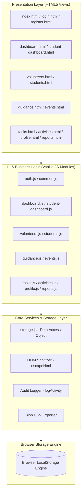
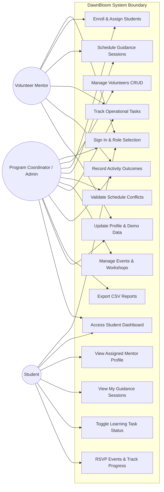
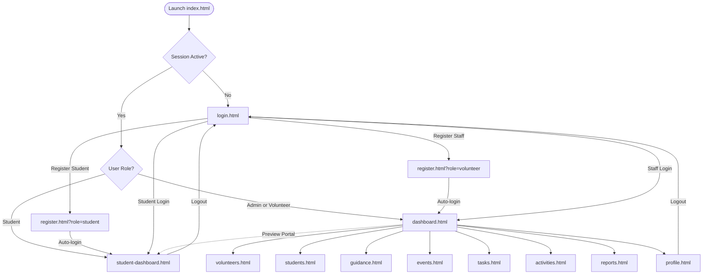
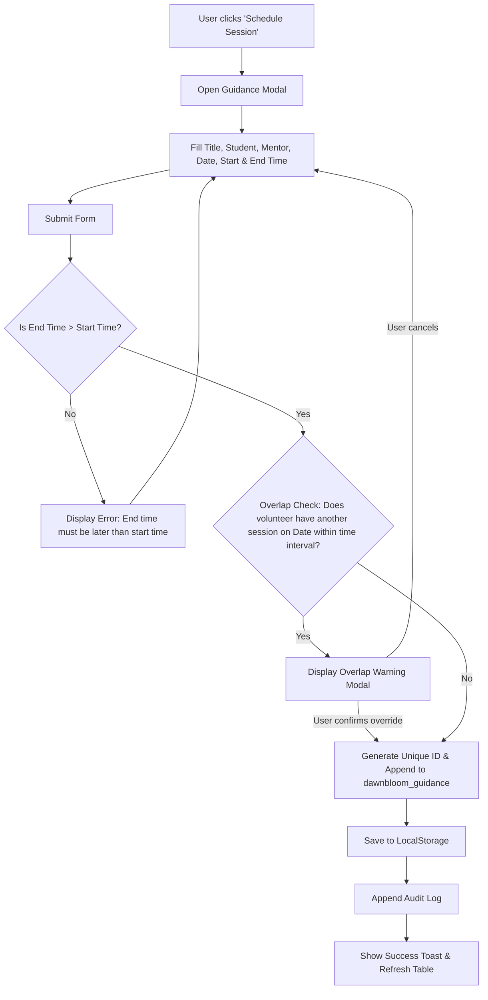

# System Architecture & Diagrams — DawnBloom

## 1. Architectural Overview

DawnBloom adopts a **modular frontend-only architecture**. The presentation layer consists of semantic HTML5 views styled with an encapsulated CSS3 design system. User interactions are dispatched to discrete JavaScript controller modules which delegate persistence, data serialization, and validation to a centralized `storage.js` layer interacting directly with the browser's `localStorage` engine.

---

## 2. Use Case Diagram

---

## 3. Navigation & Screen Flow Diagram

---

## 4. Guidance Session Scheduling Activity Flow

